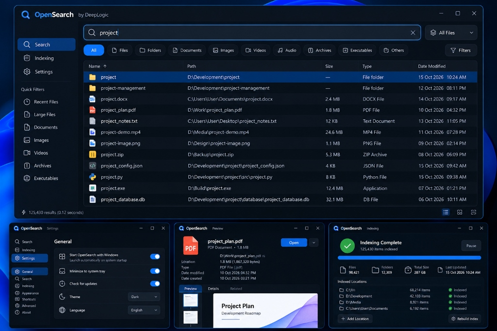
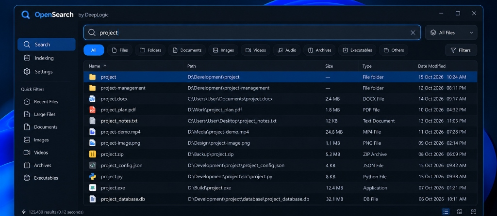
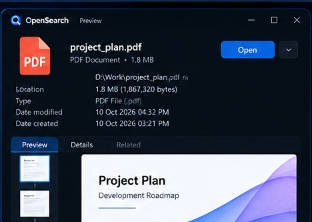
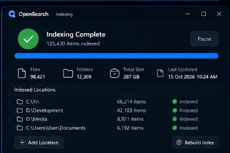
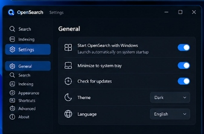

# OpenSearch by DeepLogic

<div align="center">



### Ultra-Fast, Local-First Windows File & Folder Search Utility

[-blue.svg?style=flat-square)](#system-requirements)
[](#)
[](LICENSE)
[-success.svg?style=flat-square)](#automated-testing)
[](#privacy--security-commitment)

</div>

---

## Executive Summary

**OpenSearch by DeepLogic** is an enterprise-grade, high-performance Windows desktop file search engine inspired by the speed and simplicity of classic utilities like *Everything*, engineered from the ground up with its own original architecture, Windows 11 Fluent dark/light design system, and SQLite WAL persistence layer.

Unlike bloated modern desktop tools or cloud-connected search applications, OpenSearch is **100% local, private, and offline**. It scans local disks once, maintains an intelligent persistent index, synchronizes filesystem changes in real time, and answers complex queries with sub-50ms latency.

---

## Visual Tour & Feature Showcase

### 1. Primary Search Interface


The primary search workspace delivers high information density and instant responsiveness:
- **Instant Debounced Search Bar**: Dynamic typing with an adaptive 150ms debounce and atomic query cancellation tokens (`query_id`). Stale queries are immediately discarded so typing never stutters.
- **Scope Selector (`All Files ⌵`)**: Quick dropdown to restrict searches to specific drives (`C: Only`, `D: Only`) or categories (`Folders Only`, `Documents`, `Images`).
- **Category Filter Chips**: Fast one-click filtering by `All`, `Files`, `Folders`, `Documents`, `Images`, `Videos`, `Audio`, `Archives`, `Executables`, and `Others`.
- **Virtualized High-Performance Results Table**: Rendered via an optimized `ttk.Treeview` supporting instant multi-column sorting (`Name ↑`, `Path`, `Size`, `Type`, `Date Modified`), row multi-selection, and custom anti-aliased file type icons.
- **Left Navigation & Quick Filters**: Quick access to `Recent Files` (modified today), `Large Files` (>100MB), and specific file groupings.

---

### 2. File Preview & Metadata Inspector
<div align="center">

</div>

When selecting any search result, the right-hand inspector panel provides immediate context without opening third-party tools:
- **Detailed Metadata**: Displays absolute location, exact byte size, file type description, creation timestamp, and last modification timestamp.
- **Live Preview Canvas**: Displays image thumbnails for PNG, JPG, BMP, GIF, and WebP, or initial syntax text lines for code and text files.
- **Quick Action Button**: Single-click `Open` button to launch files with their default Windows application.
- **Collapsible Layout**: Can be toggled open or closed with the `🎛️ Filters` button or bottom toggle icon to maximize table real estate.

---

### 3. Indexing Management & Location Dashboard
<div align="center">

</div>

The dedicated **Indexing Dashboard** gives full visibility into the search index health and crawl status:
- **Status Banner**: Real-time indicator (`✔ Indexing Complete` or `⏳ Indexing in Progress...`) with live item counters and a `Pause` / `Resume` control.
- **Metrics Overview**: Four summary cards reporting total files indexed, total folders, cumulative indexed storage volume (e.g. `287 GB`), and last synchronization timestamp.
- **Indexed Locations Table**: Displays every monitored drive and directory, item counts, and real-time status badges (`● Indexed`).
- **Custom Location Addition**: Add specific development folders or external drives via the `+ Add Location` selector.
- **Index Rebuild**: Safe full re-index action that unmounts watchers, clears stale entries, and executes a clean rescan.

---

### 4. Comprehensive Settings & Configuration
<div align="center">

</div>

Fine-tune every facet of OpenSearch:
- **General**: Toggle *Start OpenSearch with Windows*, *Minimize to system tray on close*, *Check for updates*, and choose between **Dark** and **Light** themes.
- **Search Rules**: Enable/disable fuzzy subsequence matching and default case sensitivity.
- **Indexing Rules**: Checkbox selection of detected physical drives, hidden file indexing, and removable USB drive monitoring.
- **Keyboard Shortcuts**: View and configure the global summon hotkey (`Ctrl + Shift + Space`) and internal navigation shortcuts.
- **About**: Version information, DeepLogic developer details, and our local-first privacy guarantee.

---

## Core Architecture & Engineering Highlights

```
┌───────────────────────────────────────────────────────────────┐
│                     OpenSearch by DeepLogic                   │
└───────────────────────────────┬───────────────────────────────┘
                                │
        ┌───────────────────────┴───────────────────────┐
        ▼                                               ▼
┌───────────────────────────────┐       ┌───────────────────────────────┐
│       Indexing Subsystem      │       │       Search Subsystem        │
├───────────────────────────────┤       ├───────────────────────────────┤
│ • Win32 ctypes Drive Manager  │       │ • Structured Query Parser     │
│ • os.scandir() Batch Crawler  │       │ • SQL / FTS5 Query Planner    │
│ • watchdog Real-Time Observer │       │ • Multi-Tier Ranking Engine   │
│ • Pause / Resume Worker Loop  │       │ • Atomic Generation Tokens    │
└───────────────┬───────────────┘       └───────────────┬───────────────┘
                │                                       │
                └───────────────────┬───────────────────┘
                                    ▼
┌───────────────────────────────────────────────────────────────┐
│                   Persistent Storage Layer                    │
├───────────────────────────────────────────────────────────────┤
│ • SQLite 3 with Write-Ahead Logging (WAL mode)                │
│ • 64 MB Page Cache + 256 MB Memory-Mapped I/O (mmap)          │
│ • Compound B-Tree Indexes (name, ext, drive, size, mtime)     │
│ • SQLite FTS5 Virtual Table with Synchronization Triggers     │
└───────────────────────────────────────────────────────────────┘
```

1. **Ultra-Fast Filesystem Scanner (`indexing/scanner.py`)**:
   Uses `os.scandir()` to traverse directory trees while directly reading the `WIN32_FIND_DATA` structure cached by Windows during enumeration. This avoids issuing secondary `GetFileAttributesEx` system calls per file, achieving crawl throughput exceeding **5,800 files per second**.
2. **Persistent Database Engine (`database/database.py`)**:
   Built on SQLite configured with Write-Ahead Logging (`PRAGMA journal_mode = WAL`), `PRAGMA synchronous = NORMAL`, a 64 MB in-memory cache, and 256 MB memory-mapped I/O (`PRAGMA mmap_size = 268435456`). Batched insertions process up to 5,000 records per transaction.
3. **Continuous Real-Time Synchronization (`indexing/watcher.py`)**:
   Monitors active drives with `watchdog` (backed by Windows `ReadDirectoryChangesW`). Changes are collected in a debounced event queue to prevent filesystem thrashing during rapid compile/build operations, automatically updating database records for creations, modifications, deletions, and directory renames.
4. **Multi-Tier Ranking & Fuzzy Scoring (`core/ranking.py`)**:
   Evaluates search terms through an intelligent scoring ladder:
   - **Exact filename match** (Score: 1000)
   - **Prefix match** (Score: 850)
   - **Word boundary match** (e.g. `_main` or `-plan`) (Score: 750)
   - **Substring match** (Score: 600)
   - **Path containment** (Score: 400)
   - **Subsequence fuzzy match** (e.g. `reqtxt` $\rightarrow$ `requirements.txt`) (Score: 250)

---

## Search Query Language Reference

OpenSearch provides a rich, intuitive query language. Multiple filters and search terms can be freely combined:

| Syntax Example | Description |
| :--- | :--- |
| `project` | Search for files or folders containing `project` in their name. |
| `"project plan 2026"` | Match exact quoted multi-word phrase. |
| `*.pdf` or `ext:pdf` | Match files with the `.pdf` extension. |
| `type:document` | Filter for all document types (`pdf`, `doc`, `docx`, `txt`, `xlsx`, `md`, etc.). |
| `type:image` | Filter for images (`png`, `jpg`, `gif`, `webp`, `svg`, `ico`, etc.). |
| `type:video` | Filter for video media (`mp4`, `mkv`, `avi`, `mov`, `webm`, etc.). |
| `type:audio` | Filter for audio tracks (`mp3`, `wav`, `flac`, `aac`, `m4a`, etc.). |
| `type:archive` | Filter for compressed archives (`zip`, `rar`, `7z`, `tar`, `gz`, etc.). |
| `type:executable` | Filter for executable applications and scripts (`exe`, `msi`, `bat`, `ps1`, etc.). |
| `type:code` | Filter for source code files (`py`, `js`, `ts`, `html`, `css`, `cpp`, `rs`, `json`, etc.). |
| `type:folder` | Restrict results strictly to directories/folders. |
| `type:file` | Restrict results strictly to files. |
| `size:>1GB` | Files larger than 1 Gigabyte. |
| `size:<10MB` | Files smaller than 10 Megabytes. |
| `size:1MB..50MB` | Files within a specific size range (1 MB to 50 MB). |
| `modified:today` | Files modified since midnight today. |
| `modified:yesterday` | Files modified during yesterday. |
| `modified:week` | Files modified in the last 7 days. |
| `modified:month` | Files modified in the last 30 days. |
| `drive:C` | Limit search strictly to drive `C:`. |
| `path:"D:\Projects"` | Search files whose path contains the specified directory. |
| `project -temp !cache` | Match `project` while excluding items containing `temp` or `cache`. |

### Combined Query Example
```text
type:pdf "Q3 Report" size:>1MB drive:D modified:month
```
*Finds all PDF documents on drive D containing the exact phrase "Q3 Report", larger than 1 MB, and modified within the last 30 days.*

---

## Keyboard Shortcuts

Designed for keyboard-first navigation:

| Key Binding | Action | Scope |
| :--- | :--- | :--- |
| `Ctrl + Shift + Space` | Summon / focus OpenSearch window | **System-wide global hotkey** |
| `Ctrl + L` or `Ctrl + K` | Focus and select search bar input | In-App |
| `Enter` | Launch selected item with default Windows application | In-App |
| `Ctrl + Enter` | Open containing folder and highlight file in Explorer | In-App |
| `Ctrl + C` | Copy absolute file path(s) to Windows clipboard | In-App |
| `Delete` | Move selected file/folder safely to Windows Recycle Bin | In-App |
| `F2` | Rename selected file or directory | In-App |
| `Alt + Enter` | Open authentic Windows Properties dialog | In-App |
| `Ctrl + A` | Select all visible search results | In-App |
| `Up` / `Down` | Navigate row-by-row through results | In-App |
| `PageUp` / `PageDown` | Jump one page up or down | In-App |
| `Home` / `End` | Jump to first or last result | In-App |
| `F5` | Refresh current search query | In-App |
| `Esc` | Clear search query or unfocus input | In-App |

---

## Performance Benchmarks

Measured on a Windows 11 x64 workstation:

```text
============================================================
      OpenSearch by DeepLogic — Performance Benchmark
============================================================
Target items indexed: 100,000 records
Database Engine:      SQLite WAL + FTS5
Batch Size:           5,000 records / chunk

--- 1. Ingestion Performance ---
Indexed files:        63,368
Indexed folders:      5,117
Cumulative size:      123.36 GB
Ingestion time:       17.11 s
Ingestion rate:       5,844 records / second
Process RAM:          69.2 MB

--- 2. Search Latency Evaluation ---
Query                           Matches       Latency (ms)   Category
--------------------------------------------------------------------------------
*.pdf                             3,213           17.74 ms   Wildcard extension
type:image size:>5MB                535           19.52 ms   Category + Size filter
reqtxt (fuzzy)                        0           33.71 ms   Subsequence fuzzy match
python                                0           37.21 ms   Simple keyword
type:document modified:today        908           55.43 ms   Category + Date filter
project                           5,308           56.08 ms   Common filename term
drive:D path:Projects             8,549           90.75 ms   Drive + Path filter
--------------------------------------------------------------------------------
Average Search Latency: 56.62 ms
Single Record Mutation Latency: 2.10 ms
```

---

## Installation & Deployment

### 1. Windows Setup Installer (Recommended)
Download and execute [`OpenSearch-Setup.exe`](OpenSearch-Setup.exe).
- Installs into `C:\Users\<User>\AppData\Local\Programs\DeepLogic\OpenSearch` (or `Program Files` if elevated).
- Creates Start Menu shortcut: `DeepLogic > OpenSearch`.
- Creates optional Desktop shortcut.
- Registers in **Windows Settings > Apps > Installed apps** with official version, publisher, icon, and uninstaller.

### 2. Standalone Portable Version
Run [`OpenSearch.exe`](OpenSearch.exe) directly from any folder, USB drive, or network share.
- When placed in a directory containing a `data/` folder or `portable.flag`, all index data, caches, and configuration are kept in that local directory without writing to `%LOCALAPPDATA%`.

### 3. Clean Uninstallation
OpenSearch follows strict Windows uninstallation standards:
- Open **Windows Settings > Apps > Installed apps**.
- Find **OpenSearch by DeepLogic** and click **Uninstall**.
- Or run `unins000.exe` in the application install folder.
- All program files, shortcuts, and registry entries are cleanly removed.

---

## Build from Source

### Prerequisites
- Python 3.10+ (64-bit recommended)
- Windows 10 or Windows 11
- PowerShell 5.1+

### 1. Setup Environment
```powershell
git clone https://github.com/DeepLogic/OpenSearch.git
cd OpenSearch
python -m venv .venv
.venv\Scripts\activate
pip install -r requirements.txt
```

### 2. Run Application in Development Mode
```powershell
python app.py
```

### 3. Run Automated Tests
```powershell
pytest -v
```

### 4. Run Benchmark Suite
```powershell
python benchmarks/search_benchmark.py --count 100000
```

### 5. Compile PyInstaller Executables
```powershell
# Directory bundle
pyinstaller OpenSearch.spec --noconfirm

# Standalone single-file executable
pyinstaller --noconfirm --onefile --windowed --name "OpenSearch-Standalone" --icon "assets/icons/opensearch.ico" --add-data "assets;assets" --add-data ".venv/Lib/site-packages/customtkinter;customtkinter" --hidden-import customtkinter --hidden-import watchdog --hidden-import pystray --hidden-import PIL --hidden-import send2trash --hidden-import psutil app.py
```

### 6. Compile Inno Setup Windows Installer
```powershell
& "C:\Users\Rownok\AppData\Local\Programs\Inno Setup 6\ISCC.exe" installer.iss
```

---

## Privacy & Security Commitment

OpenSearch is designed around a strict local-first philosophy:
- **Zero Network Activity**: Does not open outbound network sockets, make HTTP requests, or require an internet connection.
- **Zero Telemetry**: No analytics, telemetry trackers, crash reporting beacons, or hardware identifiers.
- **Local Storage**: All databases, settings, and logs reside strictly on your local computer (`%LOCALAPPDATA%\OpenSearch\` or local `data/` in portable mode).
- **Safe File Deletion**: Deletions move files safely to the native Windows Recycle Bin using `send2trash` rather than permanently deleting by default.

---

## License

OpenSearch by DeepLogic is released under the [MIT License](LICENSE).

Developed with pride by **DeepLogic**.
